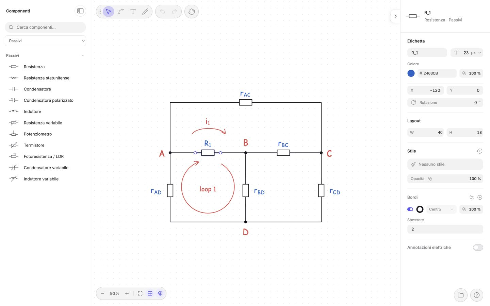

<p align="center">
  
</p>

<h1 align="center">DrawCircuit</h1>

<p align="center">Schemi elettrici, con semplicità.</p>
<p align="center">Un editor open source essenziale per creare schemi elettrici chiari nel browser.</p>

<p align="center">
  <a href="https://andrelombardo.github.io/drawcircuit/"><strong>Apri DrawCircuit →</strong></a>
</p>

<p align="center">
  <a href="README.md"></a>
</p>

<p align="center">
  
</p>

<p align="center">
  <a href="docs/it/guide.md">Guida utente</a> · <a href="CONTRIBUTING.it.md">Contribuire</a>
</p>

## Che cos’è DrawCircuit?

DrawCircuit è un editor gratuito utilizzabile dal browser, pensato per studenti, docenti e chiunque abbia bisogno di rappresentare un circuito elettrico con chiarezza. Crea uno schema, perfezionane la disposizione, aggiungi annotazioni e copialo nei tuoi appunti o documenti, senza registrarti né installare nulla.


## Funzionalità

- **Disegna con precisione.** Scegli tra 72 simboli elettrici suddivisi in 12 categorie. Collega i componenti con fili ortogonali, a 45° o con percorso libero, grazie agli strumenti di aggancio e allineamento.
- **Spiega con le immagini.** Aggiungi etichette matematiche, marcatori di polarità, annotazioni di tensione e corrente, frecce ed evidenziazioni modificabili. Le espressioni in stile LaTeX vengono visualizzate con KaTeX.
- **Mantieni tutto allineato.** Sposta, ruota, specchia, distribuisci e distanzia gli elementi con controlli precisi. I collegamenti seguono le modifiche.
- **Crea più velocemente.** Cerca nomi italiani o inglesi in cima alla libreria, filtra per categoria e usa 25 blocchi pronti o i tuoi blocchi personali. Il filo è accessibile con un clic dalla toolbar.
- **Porta i tuoi schemi ovunque.** Copia l’intero circuito, o soltanto una selezione, come PNG trasparente. Scarica progetti `.drawcircuit` modificabili e riaprili con validazione e protezione tramite Annulla. Il lavoro si salva anche automaticamente nel browser.

## Inizia a usare DrawCircuit

**[Apri DrawCircuit](https://andrelombardo.github.io/drawcircuit/)** e inizia a disegnare:

1. Scegli un componente dalla libreria e clicca per posizionarlo.
2. Premi **W** per collegare i terminali con fili; usa **N** per aggiungere nodi.
3. Fai doppio clic su un’etichetta per modificarla oppure seleziona un oggetto per regolarne le proprietà.
4. Fai clic destro sulla selezione e scegli **Copia come immagine** per usarla altrove.

Per scorciatoie, annotazioni, strumenti di disposizione e blocchi riutilizzabili, consulta la **[guida utente](docs/it/guide.md)**.

> [!note]
> **Il tuo lavoro resta nel browser.** Disegni, blocchi personali e preferenze vengono salvati localmente. La cancellazione dei dati del browser potrebbe eliminarli. Usa **Progetto → Scarica progetto**, accanto ad Aiuto, per conservarne una copia separata.

## Esegui in locale

Usa **Node.js 26.5.0** (vedi [`.nvmrc`](.nvmrc)) e npm:

```bash
git clone https://github.com/andrelombardo/drawcircuit.git
cd drawcircuit
npm ci
npm run dev
```

Apri l’URL locale mostrato da Vite. Per verificare le modifiche:

```bash
npm run lint
npm test
npm run build
```

## Contribuire

Segnalazioni di bug, idee e pull request sono benvenute. Leggi [CONTRIBUTING.it.md](CONTRIBUTING.it.md) prima di apportare modifiche oppure consulta le [issue](https://github.com/andrelombardo/drawcircuit/issues).

## Licenza

Distribuito con [licenza MIT](LICENSE) © 2026 Andrea Lombardo. Le risorse di terze parti mantengono le rispettive licenze, incluso Comic Relief con [SIL Open Font License](src/fonts/comic-relief/OFL.txt).
